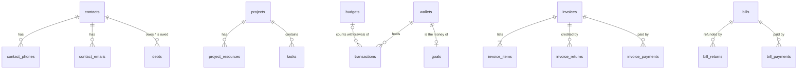

# Database schema (proposal)

The app stores everything in `data/*.json` through `createJsonStore()` (see
[ARCHITECTURE.md §12](./ARCHITECTURE.md)). This is the relational equivalent, ready to
back a real backend. The runnable DDL is [`schema.sql`](./schema.sql) (PostgreSQL 15+).

## Tables by area

| Area | Table | Today's JSON file | Notes |
|---|---|---|---|
| Settings | `currencies` | `currencies.json` | ISO codes; seeded USD, LBP |
| | `timezones` | `timezones.json` | city + IANA zone |
| | `logos` | `logos.json` | image stored as bytes + mime type |
| Personal | `contacts` | `contacts.json` | |
| | `contact_phones`, `contact_emails` | inside the contact | many per contact |
| | `purchase_items` | `purchases.json` | "to buy" list |
| | `stash_items` | `stash.json` | status: pending / in-progress / done |
| Work | `projects` | `projects.json` | |
| | `project_resources` | inside the project | many links per project |
| | `tasks` | `tasks.json` | optional project **or** category |
| | `tickets` | `tickets.json` | help desk |
| Financial | `debts` | `debts.json` | → `contacts` |
| | `wallets` | `wallets.json` | |
| | `transactions` | `transactions.json` | → `wallets`, → `budgets` (optional) |
| | `goals` | `goals.json` | one-to-one with a `wallets` row |
| | `budgets` | `budgets.json` | |
| | `assets` | `assets.json` | |
| | `subscriptions` | (new, no JSON file) | next renewal is derived from `start_date` + `cycle` |
| | `invoices`, `invoice_items`, `invoice_returns`, `invoice_payments` | `invoices.json` (nested) | |
| | `bills`, `bill_returns`, `bill_payments` | `bills.json` (nested) | |

Views (derived, never stored): `wallet_balances`, `invoice_totals`, `bill_totals`.

## Relationships

`currencies`, `timezones`, `logos`, `purchase_items`, `stash_items`, `tickets`, `assets` and `subscriptions` stand alone.

## Rules the database should keep enforcing

These exist today as `InUseError`s and validation in `server.ts` files:

- Cannot delete a **contact** with debts, a **project** with tasks, a **wallet** with transactions
  or belonging to a goal → `ON DELETE RESTRICT`.
- A **wallet's currency** can't change once it has transactions.
- A **wallet balance** can never go negative (deleting/editing a deposit is refused if it would).
- Invoice/bill: **returns + payments ≤ total**; editing the total can't drop below them.
- A task has a **project or a category**, not both; end date ≥ start date everywhere.

The first group is declarative in `schema.sql`. The balance and "returns + payments ≤ total" rules
need a service-layer check inside a transaction (or a constraint trigger); keep the same checks
that `server.ts` has now.

## Decisions to confirm

1. **Engine:** PostgreSQL (written here) vs SQLite — the DDL is nearly portable; swap `uuid` /
   enums / `timestamptz` for text / CHECKs.
2. **Customer / vendor names** on invoices and bills stay free text (a name picked from Contacts),
   so renaming or deleting a contact never rewrites history. Say so if you'd rather link by id.
3. **Single owner:** no `users` table. Add `owner_id` to every table if multi-user is ever wanted.
4. **Migration:** a one-off script reads `data/*.json` and inserts rows, splitting the nested arrays
   (phones, emails, resources, items, returns, payments) into their tables.
