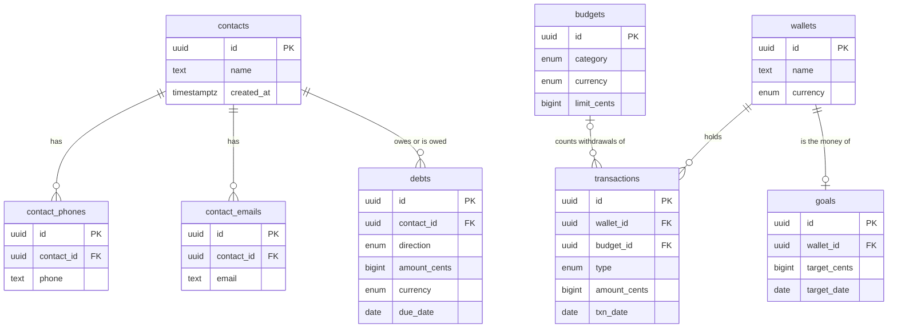
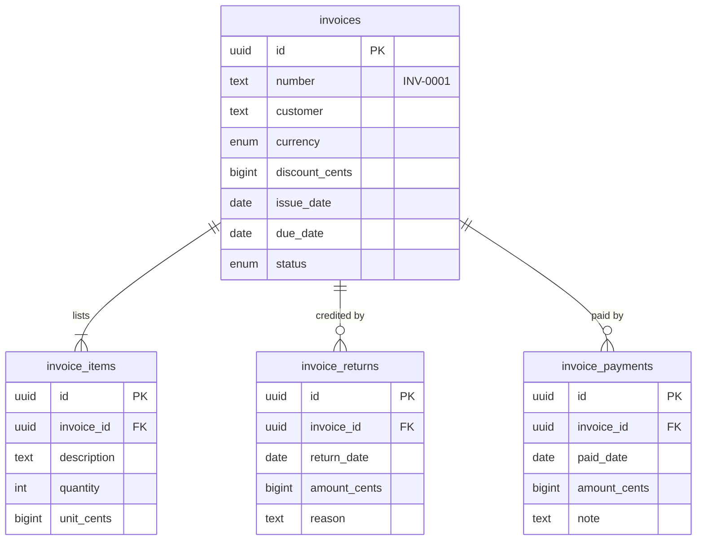
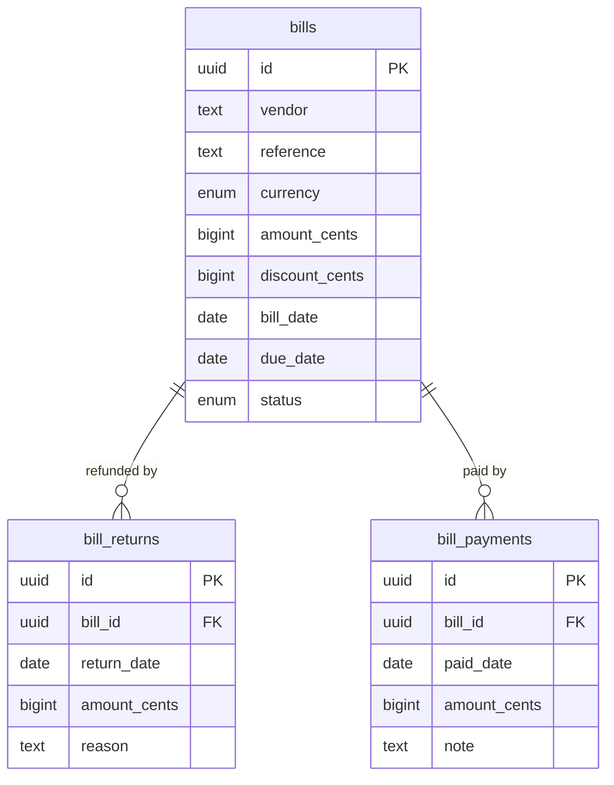
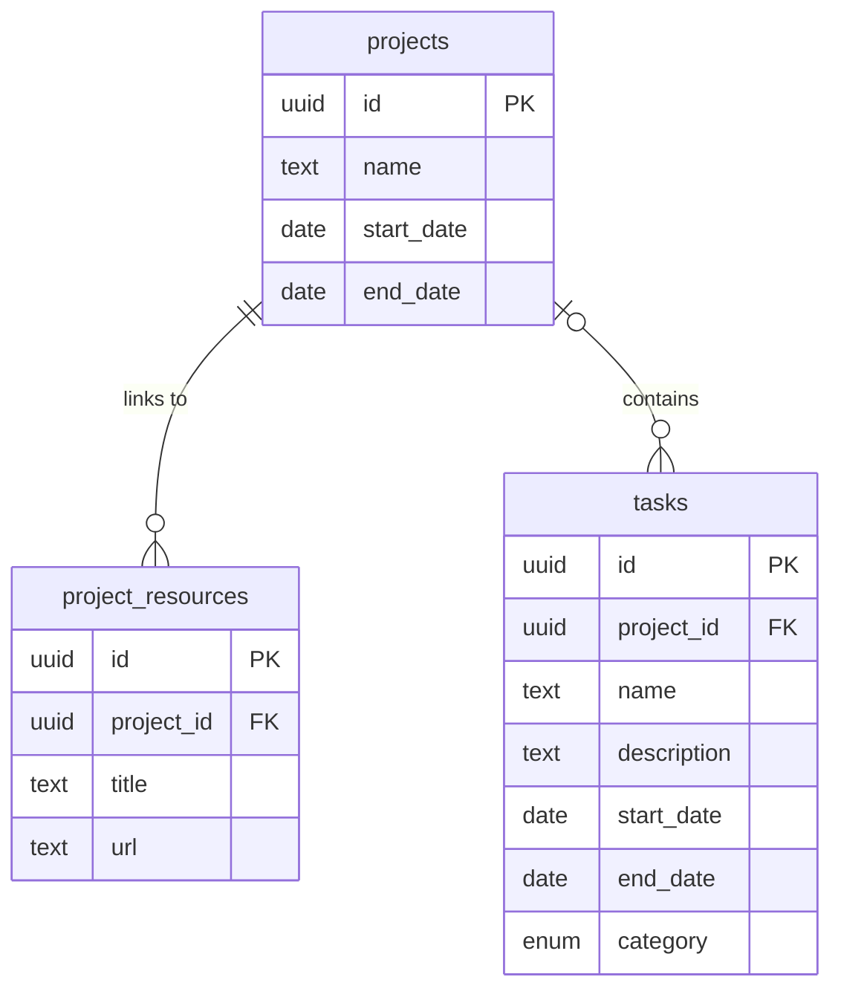
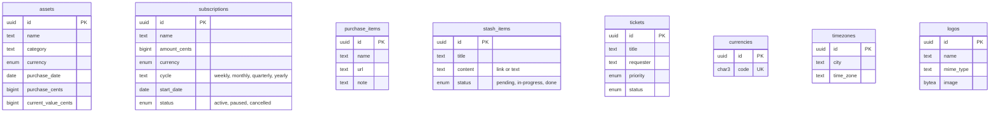

# ERD

Five diagrams cover all 27 tables (key columns only; `docs/schema.sql` has every column and constraint).
Every table also has `created_at timestamptz`. Notation: `||` exactly one, `|o` zero or one,
`o{` zero or many, `|{` one or many.

### Money: contacts, debts, wallets, transactions, goals, budgets

Balances are never stored: a wallet's balance is its deposits minus its withdrawals (view
`wallet_balances`). A goal owns a wallet; its name and currency come from that wallet.
`RESTRICT`: a contact with debts, a wallet with transactions or a goal cannot be deleted. `CASCADE`: deleting a contact removes its phones and emails.

### Invoices: money owed to you

`customer` is a name picked from Contacts and kept as plain text (not a foreign key). Deleting an
invoice cascades to its items, returns and payments. Rule: returns + payments <= total
(view `invoice_totals`).

### Vendor bills: money you owe

A bill has a single amount (no line items). `vendor` is plain text like `customer`. Deleting a bill
cascades to its returns and payments. Rule: returns + payments <= total (view `bill_totals`).

### Work: projects and tasks

A task has a project or a category, never both. `RESTRICT`: a project with tasks cannot be deleted.
`CASCADE`: deleting a project removes its links.

### Standalone tables (no relations)

Views (derived, never stored): `wallet_balances`, `invoice_totals`, `bill_totals`.
